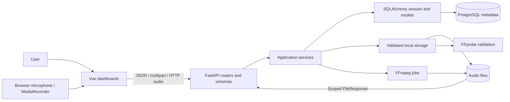
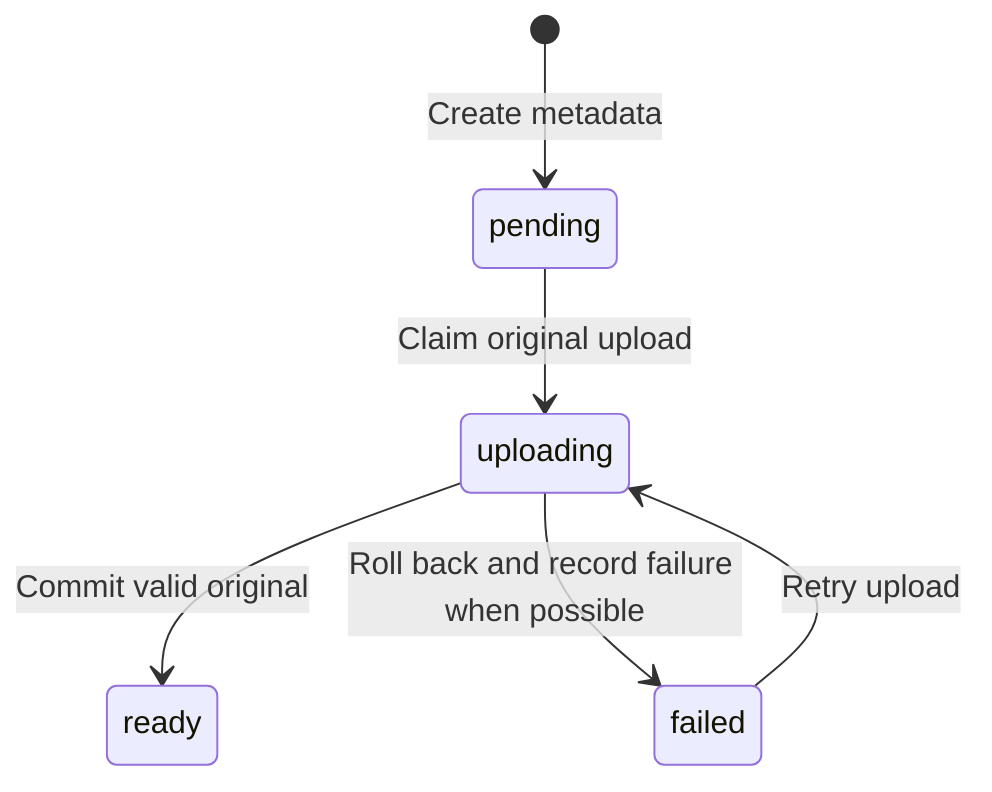

# System architecture

VoiceClean separates browser interaction, HTTP/API logic, relational metadata,
and audio bytes. It runs locally as a Vue/Vite frontend and a FastAPI backend,
with PostgreSQL and filesystem storage on the developer's machine.

## Technology responsibilities

| Technology | Responsibility |
| --- | --- |
| JavaScript and Vue 3 | Dashboard rendering, reactive state, microphone controls, requests, native audio players |
| Vite | Frontend development server and production build |
| Python and FastAPI | HTTP endpoints, request validation, dependency injection, file responses |
| Uvicorn | ASGI server that runs the FastAPI application |
| Pydantic/settings | Request/response schemas and environment configuration |
| SQLAlchemy and Psycopg | ORM models, sessions, transactions, PostgreSQL connections |
| PostgreSQL | Lecturer, recording, reference, and audio metadata integrity |
| Alembic | Explicit database schema migrations |
| FFprobe | Audio decoding/inspection and technical metadata validation |
| FFmpeg | Fixed speech enhancement and MP3 conversion |

Python is the backend language; FastAPI is its web framework. FFmpeg is an
external executable, not a Python audio-processing library in this application.

## Component map



The browser never connects directly to PostgreSQL or filesystem paths. API
responses provide scoped playback/download URLs. The backend does not mount the
storage directory as public static content.

## Repository layers

```text
frontend/src/
  components/       Workspace shell, layout, dashboards, feature/shared controls
  composables/      Shared session, audio version jobs, preview replacement guard
  services/         Fetch wrapper, persistence/retry helpers, API operations
  styles/           Tokens, shared styles, navigation, dashboard compositions
  utils/            Date and duration formatting
backend/
  app/main.py       FastAPI setup, CORS, middleware, router registration
  app/core/         Settings, connection/session dependency, upload body limits
  app/models/       Four SQLAlchemy models and status/role definitions
  app/schemas/      Pydantic request/response contracts
  app/routers/      Health, lecturer/reference, recording/version routes
  app/services/     Database operations, validation, file handling, audio jobs
  migrations/       Schema and custom PostgreSQL triggers/indexes
  storage/          References, originals, processed WAV, exported MP3
  tests/            Health, database, API, audio, live Vue/API integration
```

Routers parse HTTP inputs and call services. Schemas validate data and shape
responses. Models describe persisted entities. Services coordinate database and
filesystem operations. Storage code enforces path, size, and audio rules.

## Reference upload flow

```mermaid
sequenceDiagram
    participant UI as Vue reference panel
    participant API as Lecturer router
    participant Storage as ReferenceStorage / FFprobe
    participant DB as PostgreSQL
    UI->>API: POST lecturer samples (file + optional label)
    API->>DB: Require lecturer
    API->>Storage: Stage, count bytes, inspect decoded audio
    Storage-->>API: Relative path + verified metadata
    API->>DB: Insert reference AudioFile + VoiceSample
    API->>DB: Commit together; deferred ownership checks run
    DB-->>API: Commit success
    API-->>UI: Sample metadata + scoped audio URL
    UI->>API: Reload saved samples / play audio
```

The file is retained only when it may belong to committed metadata. Confirmed
database rollback triggers cleanup; uncertain commit outcomes require
reconciliation before deleting bytes.

## Lecture capture and persistence

1. Browser MediaRecorder captures audio into an in-memory Blob. The existing
   waveform is decorative recording animation, not a measured audio level.
2. Vue creates recording metadata with a stable draft UUID. An identical UUID
   retry can return the existing row; conflicting metadata returns 409.
3. Vue uploads the original file to that recording. The backend locks the parent
   recording, validates audio, inserts its original AudioFile, and commits ready
   status with the metadata.
4. The preview switches to the backend URL after saving. History and versions
   reload through APIs after page reconstruction or backend restart.
5. Enhancement/export generate separate AudioFile rows and separate files. The
   original is not replaced.



`uploading` exists inside the upload transaction. Other readers can still see
the last committed state. A process crash rolls the transaction back instead of
leaving a permanent upload claim. Body-limit rejection before the handler may
leave a recording pending. Generation keeps recording status ready; its busy
state is local to the HTTP request and frontend.

## Transactions and concurrency

PostgreSQL and the filesystem do not share a distributed transaction.

| Operation | Consistency rule |
| --- | --- |
| Reference upload | Create reference audio/sample in one DB commit; remove newly written bytes after confirmed non-commit |
| Original upload | Lock recording with `FOR UPDATE NOWAIT`; commit original metadata and ready state together |
| Enhancement/export | Hold parent lock during validation, conversion, and commit; reuse a validated matching preset when possible |
| Sample deletion | Delete sample, flush, delete linked audio metadata, commit, then unlink bytes |
| Recording deletion | Delete associated audio metadata and recording, commit, then clean physical files |
| Lecturer deletion | Relationship restrictions return a conflict while references/recordings remain |

Concurrent mutations on a claimed recording fail promptly with 409. A partial
unique index independently prevents two original attachments. A process-local
semaphore limits generation jobs; run one Uvicorn worker for this local design.

If COMMIT loses its connection, services check whether the generated audio ID
actually committed. They retain bytes when the database cannot resolve the
outcome. Refresh saved lists before retrying an ambiguous response. Cleanup after
a successful deletion can report `file_cleanup_pending: true`.

## Boundaries and current limits

There is no authentication, user authorization, speaker recognition, lecturer
isolation, transcription, durable processing queue, or cancellation service.
Lecturer/recording scoping checks ownership relationships; it is not account
security. Explicit CORS origins restrict browser access but do not authenticate
clients. The application is a local development system.

Unsaved audio is lost on browser refresh. Process crashes can leave unreferenced
staging/final files, and playback can race deletion. Backups must include both
PostgreSQL metadata and storage. See [audio recovery](audio.md#cleanup-and-recovery)
and [testing limits](testing.md).
