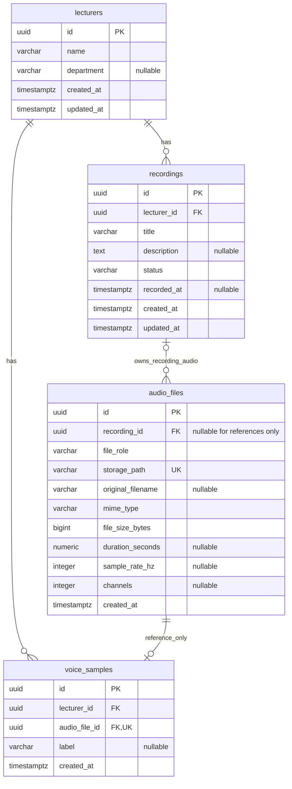

# Database design

VoiceClean stores relational metadata in PostgreSQL and audio bytes on the local
filesystem. The configured local database is `LectureRecordingSystem`. Credentials
are read from `backend/.env`; they are not included here.

The four application models are defined in
[`backend/app/models`](../../backend/app/models). Alembic also maintains the
`alembic_version` tracking table. The repository migration head is
**`f1f6a031e255`**, following initial schema revision `e64d7c1d45f7`.

## Relationships



The optional links in the diagram depend on file role: reference audio has exactly
one voice sample and no recording; every other audio file has one recording and
no voice sample.

## Columns and defaults

All `id` fields are PostgreSQL UUID primary keys. SQLAlchemy uses Python `uuid4`
for ORM inserts; PostgreSQL supplies `gen_random_uuid()` for direct SQL inserts.
All timestamps use `timestamp with time zone`; creation timestamps default to
`now()`. PostgreSQL stores instants and displays them in the connection's timezone.
All columns below are required unless marked nullable.

| Table | Columns |
| --- | --- |
| `lecturers` | `id` UUID; `name` varchar(200); `department` varchar(200), nullable; `created_at`, `updated_at` timestamptz |
| `voice_samples` | `id`, `lecturer_id`, `audio_file_id` UUID; `label` varchar(200), nullable; `created_at` timestamptz |
| `recordings` | `id`, `lecturer_id` UUID; `title` varchar(250); `description` text, nullable; `status` varchar(16), default `pending`; `recorded_at` timestamptz, nullable; `created_at`, `updated_at` timestamptz |
| `audio_files` | `id` UUID; `recording_id` UUID, nullable; `file_role` varchar(16); `storage_path` varchar(1024); `original_filename` varchar(255), nullable; `mime_type` varchar(127); `file_size_bytes` bigint; `duration_seconds` numeric(12,3), nullable; `sample_rate_hz`, `channels` integer, nullable; `created_at` timestamptz |

`updated_at` on lecturers/recordings defaults to `now()`. Database BEFORE UPDATE
triggers set it to `clock_timestamp()` for both ORM and direct SQL updates. The
ORM marks this server-generated value with `FetchedValue`; refresh the object
when the updated timestamp is needed immediately. Creation timestamps remain
unchanged on ordinary updates.

Names and titles are not unique: distinct lecturers can share a name and multiple
lectures can share a title. Optional metadata may remain unknown until later file
validation. The recording status enum contains `pending`, `uploading`, `ready`,
and `failed`. The file role enum contains `reference`, `original`, `exported`, and
`processed`. These use varchar columns with named database CHECK constraints,
not PostgreSQL enum types, making later value changes explicit migrations.

## Integrity and lifecycle

- Four foreign keys use `ON DELETE RESTRICT`: recordings to lecturers; voice
  samples to lecturers; voice samples to audio files; audio files to recordings.
  ORM parent relationships use `passive_deletes="all"` without delete cascades.
  Deleting a parent with dependent rows fails instead of silently removing or
  detaching metadata. Listing services explicitly load the related lecturer/audio metadata needed
  by their response schemas.
- A unique `voice_samples.audio_file_id` prevents sample/file sharing; unique
  `audio_files.storage_path` prevents multiple metadata rows owning the same path.
- Size and duration must be nonnegative; duration NaN is rejected. Known sample
  rates/channels must be positive. Required names, titles, paths, and MIME types
  cannot be empty or contain only spaces.
- `ck_audio_files_role_recording` requires reference files to have no recording
  and original/exported/processed files to have a recording.
- Two deferred constraint triggers enforce that reference audio has exactly one
  voice sample and other roles have none. They run for audio insertion/update and
  voice sample insertion/update/deletion. Validation locks the audio row before
  inspecting ownership. There is no circular foreign key.
- To create a reference, insert its audio metadata and voice sample in the same
  transaction, then commit. An intermediate orphan is permitted inside that
  transaction but cannot commit. `SET CONSTRAINTS ALL IMMEDIATE` checks pending
  deferred constraints early. The reference service catches commit-time integrity errors and
  rolls back the entire operation.
- To remove a reference pair, delete the voice sample first, then its audio
  metadata, and commit both together. Removing only the sample leaves an orphan
  and fails at commit. Removing its audio first fails the foreign key check.
- Exports/processed outputs are separate rows with their own unique storage
  paths; inserting them leaves the original metadata unchanged. No automatic
  deletion cascade removes original files.

PostgreSQL implements deferred ownership with constraint triggers defined in
the initial Alembic migration.
A row CHECK alone cannot ensure that a related voice sample exists, so custom
migration SQL supplies this cross-table check. Trigger functions and definitions
are maintained by explicit migrations; `alembic check` alone does not validate
custom trigger code.

The database does not inspect audio bytes or enforce file existence. The current
upload/storage services validate paths, content, size, codecs, and duration. They
coordinate physical cleanup with database commits. API responses omit storage
paths. Original uploads are immutable through the API; generated outputs use
separate rows/files. Recording state transitions are handled in application
services, while SQL constrains their allowed values.

The partial unique index `uq_audio_files_original_recording` permits at most one
`original` audio row per recording. There is no general unique constraint for
processed/exported presets; API generation serializes them with the parent row
lock and reuses validated outputs. Direct SQL writers must respect that policy.

## Indexes

Primary keys and both unique constraints supply their own indexes. Additional
indexes support common access patterns:

| Table | Additional indexes |
| --- | --- |
| `lecturers` | `name`; `created_at` |
| `recordings` | `(lecturer_id, created_at)`; `created_at`; `status` |
| `voice_samples` | `(lecturer_id, created_at)` |
| `audio_files` | `(recording_id, file_role)`; `created_at`; unique `recording_id` where `file_role = original` |

The leftmost columns of composite indexes cover foreign key lookups without
duplicating single-column indexes. The voice-sample audio foreign key uses its
unique index. See [schema.json](schema.json) for the actual inspected column
types/defaults, constraints, indexes, and four application trigger definitions.
It contains no connection credentials.

## Migrations and inspection

| Revision | Change |
| --- | --- |
| `e64d7c1d45f7` | Four tables, constraints, indexes, timestamp and deferred ownership triggers |
| `f1f6a031e255` | One-original partial unique index; current repository head |

From `backend/`:

```powershell
.\.venv\Scripts\python.exe -m alembic current
.\.venv\Scripts\python.exe -m alembic heads
.\.venv\Scripts\python.exe -m alembic check
```

Apply `alembic upgrade head` when the configured database requires the repository
migrations. Tables are never created on API startup. For a future model change,
import the model in `app/models/__init__.py`, generate and review a migration,
then apply it:

```powershell
.\.venv\Scripts\python.exe -m alembic revision --autogenerate -m "Describe model change"
.\.venv\Scripts\python.exe -m alembic upgrade head
```

Autogeneration ignores unrelated tables and does not maintain custom trigger
functions/definitions. Trigger changes need explicit migration SQL. Do not
perform application downgrades to run tests; the suite uses private schemas.

[`schema.json`](schema.json) is the preserved inspected schema snapshot for
`f1f6a031e255`, including types/defaults, constraints, indexes, and triggers. It
contains no credentials. It is a stored snapshot, not a new live inspection on
every documentation edit. Models and migrations define repository expectations;
`alembic current` reports the applied revision of your configured database.

In pgAdmin, inspect **Databases > LectureRecordingSystem > Schemas > public >
Tables**. Expected application tables are `lecturers`, `voice_samples`,
`recordings`, and `audio_files`, alongside `alembic_version`. Register the local
server using your own configured host/port/user/password. PostgreSQL is the
server; pgAdmin is its management interface.

See [architecture](../architecture.md) for transactions/storage coordination,
[backend](../backend.md) for HTTP contracts, and [testing](../testing.md) for
isolated schema verification.
